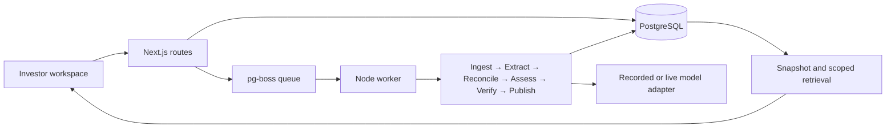

# Revisit — an evidence-backed second look

Research and implementation brief · 17 September 2026

This document preserves the proposal written before implementation. For the delivered scope and measured results, see [README](../README.md) and [verification notes](verification.md). The implementation uses a seeded company, pasted-text intake, and deterministic recorded assessments; no create-company API, crawler, or external CRM integration was added.

**Recommendation:** build a compact workspace that answers: **“We tracked this company for a reason. Does the new evidence change that decision?”** An analyst sees the earlier rationale, material changes, conflicting claims, and the next question to resolve. The analyst records the decision; the system preserves its evidence.

**Delivery constraint:** 12 hours. Default review must work without paid services or API keys. This is an implementation proposal, not a description of completed software. The repository was empty when inspected.

## 1. Loop3 research summary

Loop3 presents itself as an engineering partner building tailored data, automation, and software systems for private-capital firms. Its site does not establish a single generally available SaaS product to recreate. Investment teams struggle with disconnected tools, incomplete CRM records, fragmented research, and administrative work. [Company website](https://www.loop3.ai/)

Its published work gives us four concrete reference points:

| Published capability | What it establishes | Implication for this demo |
| --- | --- | --- |
| Sourcing platform for an unnamed US consumer/technology VC, stated $2.9B AUM | Combines PitchBook, Harmonic, and Affinity; structured reviews, assignments, and CRM outcomes. Deliberately optimized for initial qualification. | Finish a short decision workflow instead of building an exhaustive diligence portal. |
| Company and people snapshots | Preserves evolving entity information and historical state. | Show what changed and what was known when a decision was made. |
| Unified AI data and search for an unnamed US VC, stated over $2B AUM | Searches documents, audio, video, and records; case-specific technologies include Claude, OpenSearch, Neo4j, and FastMCP. | Context assembly and retrieval matter more than a prominent chat box. |
| LinkedIn–Affinity integration for an unnamed enterprise-SaaS VC, stated $3.5B AUM | Captures relationship context and supports outreach, reminders, enrichment, and duplicate prevention. | Keep the analyst's next action close to the evidence. |

Sources: [Sourcing](https://www.loop3.ai/case-studies/sourcing-platform), [Snapshots](https://www.loop3.ai/case-studies/company-and-people-snapshots), [AI search](https://www.loop3.ai/case-studies/unified-ai-data-and-search-platform), [LinkedIn integration](https://www.loop3.ai/case-studies/linked-in-affinity-integration).

The customer firms are anonymized. Logos of portfolio companies on the homepage do not establish those companies as direct customers. Case-study outcomes are company-reported; no independent performance benchmark was found. News surfacing is described as a sourcing roadmap item, not a shipped capability. [Company](https://www.loop3.ai/), [Sourcing](https://www.loop3.ai/case-studies/sourcing-platform)

Loop3's services emphasize improving information flow around existing systems and retaining human judgment for investment and relationship decisions. Its article on context describes matching new signals to historical watchlist reasons. That is the most useful product insight for this project. [Services](https://www.loop3.ai/ai-automations-and-integrations), [Context article](https://www.loop3.ai/news/the-real-ai-advantage-isn-t-chat-gpt-or-claude-it-s-context)

## 2. What their engineering team appears to care about

The role asks for 3–5+ years of backend experience, end-to-end ownership, system design, generalist ability, and Spanish/English communication. Work includes intelligence APIs, automation, multi-source financial/network data, AI memo analysis, and Affinity/PitchBook/Harmonic integrations. Listed technologies: Node.js/TypeScript, Next.js/React, SQL/NoSQL, Python, Snowflake, Azure/GCP/AWS, Lambda, API Gateway, S3, EC2, SQS, RDS, EventBridge, AppRunner, SST, and Terraform. It explicitly values clean delivery and system thinking over matching every tool. [Role](https://www.loop3.ai/careers/ssr-software-engineer)

The following is our inferred review rubric, not an official hiring rubric: coherent data contracts; reliable asynchronous processing; understandable tradeoffs; correct reconciliation; useful failure states; and a complete path from information to human action.

**Application detail to verify:** the careers index labels the position **Argentina – Remote**. The role page remains accessible, but no closing date is shown; this does not establish worldwide eligibility or confirm recruitment status. [Careers](https://www.loop3.ai/careers)

## 3. Three possible demo concepts

| Concept | Core interaction | Strength | Cost or weakness |
| --- | --- | --- | --- |
| Evidence Desk | Inspect a startup's claims against its documents. | Closest to the original idea; strong provenance and structured extraction. | Easily becomes a generic diligence summary; invites excessive categories. |
| Signal Inbox | Review a short list of new signals matched to a fund's thesis. | Clear operational value and integration boundaries. | Credibility depends on fresh external feeds; ranking can hide unsupported assumptions. |
| **Revisit** | Compare new evidence with the reason a company was previously tracked. | Combines historical context, reconciliation, retrieval, and a consequential human decision. | Requires precise treatment of dates and metric definitions. |

## 4. Why each is relevant

Evidence Desk demonstrates the contextual access problem illustrated by Loop3's search work. Signal Inbox illustrates its sourcing and signal-detection services. Revisit connects historical snapshots to an actual review action. These mappings are our interpretation of the research above, not claims that Loop3 needs a particular new feature.

## 5. Strongest opportunity to demonstrate fit

Choose **Revisit**. The application story is: “I built a narrow example of decision infrastructure: preserve the team's context, reconcile new evidence, and make the next review easier to trust.”

Challenge to the original brief: founders, competitors, funding, markets, and investment scores are not automatically useful MVP sections. A smaller workflow with correct evidence handling makes a stronger case than ten attractive but shallow panels. Neither a graph database nor multiple autonomous agents is justified by this corpus.

## 6. Exact MVP scope and success criteria

Primary user: a VC associate revisiting a tracked B2B SaaS company before deciding whether to arrange another meeting.

Build one fully developed fictional deal and a small, reusable company/source model. Include:

- A review workspace with overview, evidence, decision history, and execution details.
- A preserved earlier Track decision, two explicit thesis criteria, and dated source material.
- A source intake form for pasted text with title, type, and effective date. A website URL is source metadata, not an implicit crawl request.
- One background review pipeline, persisted progress, actionable errors, and retry.
- An investment snapshot: what changed, what is disputed, thesis status, and three founder questions.
- A source drawer showing exact passages and source/effective/capture dates.
- Four useful suggested questions plus free text in live mode; all supported answers carry evidence references.
- A human review form and downloadable, explicitly unsent CRM handoff. This is an internal exchange format, not a claimed Affinity API payload.
- A visible recorded/live execution label. Recorded mode runs the real database, reconciliation, verification, and decision path using fixture model responses. It does not pretend to perform live inference.

Keyless mode supports the curated scenario and supported recorded questions. Arbitrary input can be stored, but analysis requiring an unrecorded response clearly requests live mode; never return unrelated fixture results for custom text.

Acceptance gates:

1. A reviewer understands the prior decision, material change, and unresolved question in a three-minute walkthrough.
2. Every material generated statement has a valid passage citation or is explicitly an inference/unknown; derived values reference their inputs.
3. Different dates or definitions are not incorrectly labeled contradictions.
4. An interrupted/retried run produces one committed snapshot and no duplicate review.
5. Refreshing the page retains progress and saved decisions.
6. A failure is visible with a useful recovery action; the last completed snapshot remains usable.
7. Keyboard navigation, narrow layouts, empty/loading/error states, type checking, build, domain tests, and one end-to-end browser walkthrough pass.

## 7. The differentiating feature: decision replay

The workspace reconstructs **then → now → what this changes**, with evidence on both sides.

Use a fictional company, **Lattice Harbor**, selling procurement software. Its synthetic source pack is deliberately small:

| Source | Effective context | Relevant statement |
| --- | --- | --- |
| Earlier analyst note | 12 May 2026, referring to April | Track; revisit at 25 paying organizations and after recurring revenue is substantiated. Baseline: 12 paying organizations. |
| New founder deck excerpt | 30 June 2026 | 30 paying organizations, excluding trials and pilots. |
| New finance extract | Same date and customer definition | 24 paying organizations; recurring revenue detail is available. |
| Captured website copy | Captured 2 July 2026 | “60 teams use Lattice Harbor”; no paying-customer definition. |

Expected behavior: 12 → 24 is a historical change; 24 versus 30 is a same-period conflict; 60 teams is a different, undefined measure. The ≥25 criterion is **unresolved**, even though the new information merits review. The system asks for reconciliation of the six-account difference. It does not select the most flattering number.

Show source support and independence separately: two founder-authored documents are not independent corroboration. A faithful quotation establishes what a document says, not whether its business claim is true.

## 8. User flow and frontend direction

1. Open the populated workspace: company identity, prior decision, and a concise “new evidence” summary.
2. Run the review. Persisted stage labels explain the work; no fictional completion percentage.
3. Read the decision replay and thesis criteria: met, unmet, disputed, or unknown.
4. Select the customer-count conflict; compare both highlighted passages in a side drawer.
5. Ask “What should I ask the founders?” Receive a concise, cited answer tied to the unresolved criterion.
6. Record Continue tracking / Request clarification / Proceed to meeting, with rationale. Bind the decision to the exact snapshot reviewed.
7. Export the handoff or inspect the execution trace. Nothing is sent externally.

Visual direction: a restrained editorial workspace, warm neutral background, dark typography, one muted teal accent, subtle dividers, and tabular numbers. A compact left navigation and generous central reading column keep it familiar to investment professionals. Evidence appears beside the decision, not hidden behind an AI animation. Conflict labels include text/icons, not color alone. Mobile uses a stacked view and accessible source dialog. Keep secondary trace detail out of the primary reading path.

## 9. Architecture and tradeoffs

One repository, one Next.js application, one Node worker, one PostgreSQL database. Server-render the initial workspace; use small client components for questions, drawers, forms, and run status. REST endpoints expose stable domain operations. A durable queue separates model latency from the request lifecycle.



Proposed runtime dependencies: Next.js, React, React DOM, `pg`, `pg-boss`, Zod, the official OpenAI SDK, and Lucide React for icons. Development: TypeScript, `tsx`, and corresponding type packages. Use Node's test runner through `tsx`; avoid a separate test framework. No dependency installation has happened. Choose and lock mutually compatible current stable versions when implementation starts; inspect registry metadata rather than guessing versions. No package manager existed in the empty directory; use npm and commit its lockfile.

Use explicit SQL migrations and parameterized SQL. Drizzle is reasonable but unnecessary for this small relational model. PostgreSQL full-text retrieval plus explicit claim links is enough for a small corpus; add embeddings only if retrieval evaluations establish a need. [PostgreSQL text search](https://www.postgresql.org/docs/current/textsearch-tables.html)

Use pg-boss for durable dispatch and bounded retry rather than implementing a queue from scratch. It supports PostgreSQL-backed jobs and transaction-aware enqueueing. Application writes still need idempotency; an external model invocation cannot be made exactly once merely by selecting a queue. [pg-boss](https://pgboss.io/introduction), [Jobs](https://pgboss.io/api/jobs)

Do not use an unawaited promise or Next.js `after()` as the review queue: `after()` has route-duration constraints. The separate worker is an architectural choice based on resumability needs. [Next.js documentation](https://nextjs.org/docs/app/api-reference/functions/after)

Proposed HTTP contract:

| Operation | Result |
| --- | --- |
| Create company / append source version | Validated persisted record, 201 |
| Request review with idempotency key | Run ID and status URL, 202 |
| Read run | Persisted stages, attempts, error, result reference |
| Read company snapshot | Latest completed assessment with evidence references |
| Ask question for snapshot | Grounded result with source IDs and explicit unknowns |
| Save decision for snapshot | Immutable review, 201; duplicate key returns original result |
| Export decision | Local JSON containing rationale, snapshot, and evidence links |

Errors use a shared shape: code, human-readable message, retryability, and request ID. Bound source size and question length. Retry only transient failures. Reads of a run never start work.

Local delivery is the default. PostgreSQL is already installed on this machine; use an isolated demo database, never an existing application database. Public hosting, authentication, and production deployment remain separate decisions. No Supabase account is necessary for this MVP.

## 10. Database schema

Logical schema below; exact SQL is an implementation deliverable. UUID primary keys, foreign keys, UTC timestamps, immutable source/decision history, and application-level company scoping throughout. Store JSON only for validated artifacts and bounded metadata, not as a replacement for evidence relations.

| Table | Essential fields and purpose |
| --- | --- |
| `companies` | id, name, domain, created_at |
| `source_versions` | id, company_id, source_key, kind, title, origin_url, publisher_group, body, content_hash, published_at, captured_at, supersedes_id; immutable input versions |
| `source_chunks` | id, source_version_id, ordinal, text, character offsets, locator, search vector |
| `analysis_runs` | id, company_id, baseline_snapshot_id, baseline_decision_id, mode, status, idempotency_key, workflow_version, started_at, completed_at |
| `run_inputs` | run_id, source_version_id; frozen source manifest |
| `stage_executions` | id, run_id, stage, attempt, state, input_hash, validated_output, prompt/schema/model versions, token usage, duration, error_code; one row per attempt |
| `claims` | id, run_id, company_id, predicate, typed value, unit, effective date/period, definition_key, statement_kind, verification_status; source statements and derived facts remain distinguishable |
| `evidence` | id, claim_id, chunk_id, quote, offsets, relationship; traceable passage support |
| `claim_links` | from_claim_id, to_claim_id, relationship, rule_version, explanation; conflict, historical change, or derivation |
| `snapshots` | id, run_id, company_id, schema_version, assessment, created_at; immutable, unique run_id |
| `decisions` | id, company_id, snapshot_id, previous_decision_id, action, rationale, thesis_and_trigger_snapshot, idempotency_key, created_at |
| `questions` | id, snapshot_id, question, retrieved_chunk_ids, validated_answer, execution_metadata, created_at |

Queue tables are owned by pg-boss; do not maintain a competing homegrown jobs table. Input deduplication is scoped by company/source key/content hash. Successful stage outputs are unique per run/stage; attempt history remains append-only. FKs and transaction checks reject evidence crossing company boundaries. Index source versions by company/time, claims by run/predicate/effective date, decisions by company/time, and chunk search with GIN.

Snapshot creation and terminal run status commit together. Source additions after a run starts cannot alter its input manifest. Decisions reference the reviewed snapshot even if newer evidence subsequently arrives; the UI warns when a more recent snapshot exists. Preserve the original thesis with the decision so future edits cannot rewrite history.

## 11. AI and agent architecture

Use a bounded workflow with two model responsibilities—extracting statements and drafting a contextual assessment—not a group of agents debating the deal. Deterministic code handles normalization, comparison, dates, threshold checks, evidence validation, and publication.

| Stage | Work | Failure behavior |
| --- | --- | --- |
| Ingest | Freeze source versions; normalize text; chunk with stable locators. | Invalid/empty inputs fail with specific validation errors. |
| Extract | Structured statements with source IDs, exact quotes, dates, units, and definitions. | Runtime schema and quote validation; bounded retry; never accept fabricated IDs. |
| Reconcile | Compare compatible metrics; preserve conflict, update, and non-comparable states. | Missing definitions remain unknown; no LLM arithmetic. |
| Assess | Apply saved thesis/trigger and draft changes, risks, and founder questions from validated claims. | Return explicit insufficient-evidence fields. |
| Verify | Check citations, inputs of derived statements, snapshot scope, and output constraints. | Invalid statements block publication; preserve the last valid snapshot. |
| Publish | Commit immutable snapshot and completed status atomically. | Retry reuses completed stage outputs and cannot duplicate the snapshot. |

“Enrichment” in this MVP means adding preserved internal decision context and source metadata. Do not imply external research occurred. Source discovery and paid-provider enrichment are outside scope.

Schemas include extracted claims, normalized metrics, evidence references, assessments, thesis criteria, questions, and answers. Treat schema validity, quote validity, semantic support, and real-world truth as separate checks. Deterministic validators can prove the first two and numeric derivations; unconstrained model interpretation remains labeled. Store concise evidence-linked explanations, not hidden chain-of-thought.

Retrieval is scoped to the chosen company and immutable snapshot. Search source chunks, expand linked evidence for matching claims, and include contradictory passages plus the original review reason. A question cannot silently use sources ingested after its snapshot. If context is insufficient, answer that it is unknown. Reject unsupported citations before display. A full-text baseline is honest about semantic-recall limits; measure it on the four target questions before considering vector infrastructure.

Efficiency: hash source content, reuse successful work within a run, cap input/output sizes, use at most two concurrent extraction calls, and keep question context small. Select one live model after checking current structured-output documentation; record its exact ID. Provider credentials are optional and server-only. Source text is untrusted data: it cannot alter system instructions or invoke tools. Model adapters have no write-to-CRM or outbound-message capability.

Monitoring: record run/stage IDs, mode, attempts, latency, token usage when available, schema/prompt/model versions, citation failures, and error codes. Use structured logs and a compact in-product run inspector. Recorded runs report recorded execution, not fabricated live token usage or spend.

Recovery: initial call plus at most two transient retries with backoff; validation failures have a small explicit retry budget. A provider rejection/auth error is actionable, not retried indefinitely. Checkpoint every successful stage. Enqueue the run transactionally; stage writes and completion markers share a transaction. Abort timed-out model requests. Expose exhausted failures and explicit retry without overwriting the earlier snapshot.

## 12. Proposed repository structure

```text
src/
  app/                 pages, layouts, narrow HTTP route handlers
  components/          workspace, evidence drawer, review form, run inspector
  domain/              schemas, metric comparison, thesis evaluation, provenance
  server/
    db/                connection, parameterized repositories, migrations
    workflow/          stages, queue, execution records
    ai/                structured live adapter, recorded adapter, prompts
    retrieval/         snapshot-scoped context selection
  fixtures/            fictional sources and recorded model responses
scripts/               local database setup, seed, worker entrypoint
tests/                 reconciliation, provenance, retry, database/API integration
docs/                  research plan, architecture tradeoffs, demo walkthrough
README.md              honest setup, modes, limitations, reviewer entry points
```

Domain functions must not import React, Next.js, database clients, or model SDKs. Routes validate and delegate. Components consume typed contracts. Avoid an empty abstraction layer or separate microservice repository.

## 13. Implementation phases within 12 hours

| Budget | Deliverable | Exit gate |
| --- | --- | --- |
| 0–1 h | Research, scope, source pack, contracts | This brief and a coherent scenario exist before application coding. |
| 1–3 h | Schema, fixtures, comparison rules, worker skeleton | Same-period conflict and different-period change tests pass. |
| 3–5 h | Complete recorded pipeline and real persistence | Retry/refresh preserve one snapshot; exact source citations resolve. |
| 5–8 h | Polished workspace, evidence drawer, questions, human review | Three-minute user flow works through real APIs. |
| 8–10 h | Live structured-output adapter, validation, execution inspector | Keyless path remains complete; invalid output and transient failure exercised. |
| 10–12 h | Browser review, accessibility/responsive fixes, README, demo narrative | Type check, build, focused tests, and full browser flow pass. |

This is a time budget, not a fabricated completion estimate. If time gets tight, cut arbitrary-source live analysis before cutting provenance, durable review storage, or failure handling. Live behavior is reported as unverified unless exercised with credentials; a compiling adapter is not proof of live-provider reliability.

Test the domain's meaningful risks: 24/30/60 comparison; missing dates/units; unknown thesis criteria; invalid/mismatched citation; cross-company retrieval; duplicate enqueue; retry after stage commit; unavailable worker/provider; and decision/snapshot version binding. Avoid tests that merely repeat implementation details. Browser validation covers source inspection, questions, saved decisions, refresh, and an error/retry state.

Final reviewer package: runnable repository, keyless seeded walkthrough, concise architecture and tradeoffs, measured verification results, and a short application explanation. A hosted demo and recording can follow once the local result is reviewable and deployment is authorized.

## 14. What not to build

No full CRM, portfolio dashboard, billing, multi-tenant administration, user-management system, arbitrary web crawler, OCR, multimodal ingestion, live PitchBook/Harmonic/Affinity integration, graph database, vector service, agent framework, infinite autonomous research, automatic outreach, unsupported investment scores, or artificial confidence percentages.

No claim that this is Loop3's product or that their real client data is present. No unlabeled simulation. The project earns credibility through the quality of one complete decision workflow and the evidence behind its behavior.
